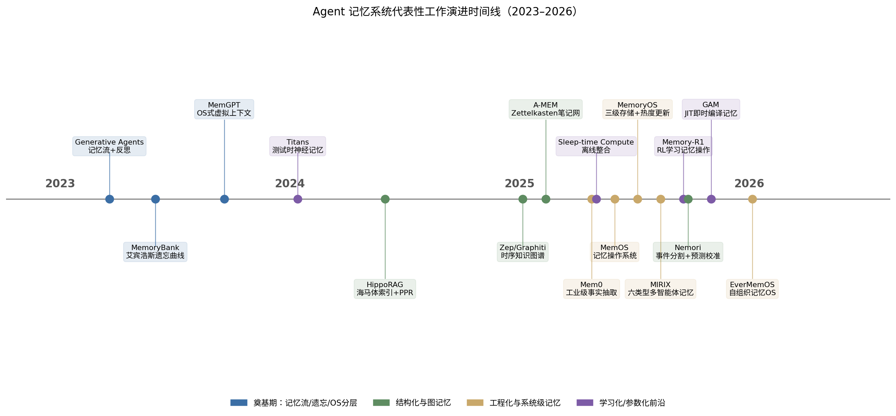
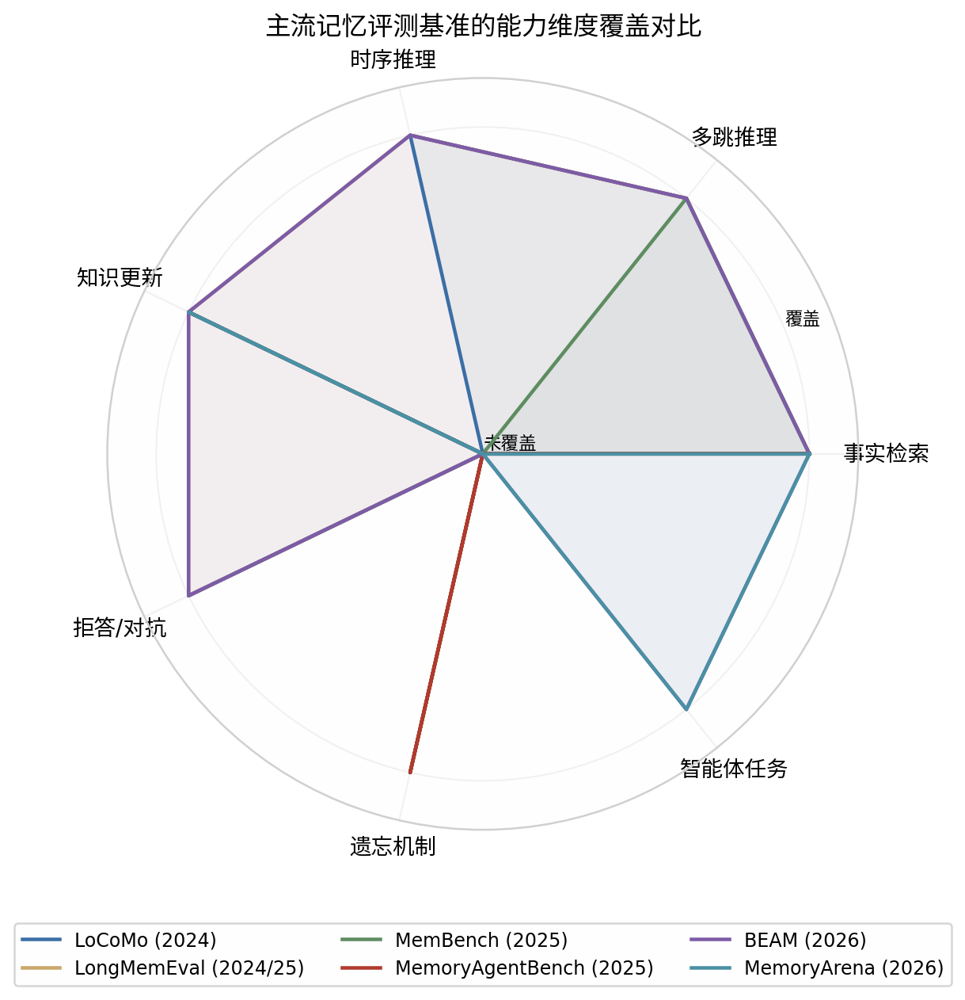
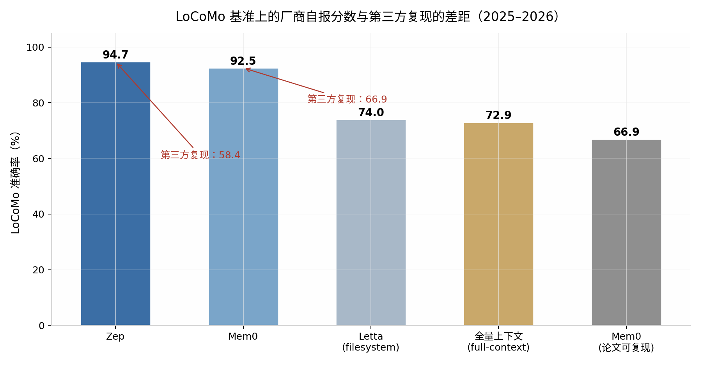

# Agent 记忆系统深度研究报告：实现范式、前沿进展与量化评测

## 摘要

大语言模型（LLM）本质上是**无状态**的：每次推理只看得见当前上下文窗口内的内容，一旦会话结束或历史超出窗口，过往信息便"蒸发"。Agent 记忆系统要解决的核心问题，就是让智能体能够跨会话**持久化、组织并选择性召回**信息，从而把一个无状态的文本生成器变成真正可适应、可演化的智能体（[Du 综述, 2026](https://arxiv.org/html/2603.07670v1)）。

本报告围绕三个问题展开：**（1）业内主流的实现方式**——从全量上下文、RAG 向量检索、分层/OS 式记忆、知识图谱记忆到参数化记忆，各有明确的能力边界；**（2）前沿论文**——2024–2026 年的代表性工作包括 A-MEM（Zettelkasten 自组织笔记网）、MemOS/MemoryOS（记忆操作系统）、MIRIX（六类型多智能体记忆）、Nemori/EverMemOS（认知科学启发的事件分割）、Memory-R1/MEM1（强化学习驱动的记忆管理）、Sleep-time Compute（睡眠时离线整合）、GAM（即时编译式记忆）以及 Titans/Nested Learning（测试时参数化记忆）；**（3）量化评价**——以 LoCoMo、LongMemEval、MemBench、MemoryAgentBench、BEAM 等基准为主干，指标覆盖准确率、检索召回、时延、Token 成本、知识更新、拒答与遗忘质量，但当前评测体系存在**厂商自报分数与第三方复现差距可达 25–36 个百分点**的"罗生门"问题，工程实践中必须建立自己的黄金评测集。

一个贯穿全报告的判断是：**长上下文 ≠ 记忆**。长上下文解决的是单次输入的容量问题，记忆解决的是跨会话的连续性问题；即便上下文窗口扩展到百万级 Token，成本、时延、"迷失在中间"效应以及事实更新的一致性，仍然需要独立的记忆架构来承担（[Digital Applied](https://www.digitalapplied.com/blog/agent-memory-architectures-vector-graph-episodic)）。

---

## 1. 记忆系统的定位与分类框架

### 1.1 为什么上下文窗口不够用

LLM 的自注意力机制决定了其"工作记忆"被限制在固定的上下文窗口内，且计算复杂度随序列长度呈二次增长，长上下文不仅成本高，还存在"迷失在中间"（lost-in-the-middle）等检索可靠性问题（[Preprints 综述](https://www.preprints.org/manuscript/202603.0359)）。更关键的是，**上下文窗口是会话级的**：窗口内的内容在会话结束后即被丢弃，无法形成跨会话的用户画像、经验积累与偏好追踪。2026 年的行业共识是"长上下文解决容量，记忆解决连续性"，二者是互补而非替代关系（[Mem0](https://mem0.ai/blog/ai-memory-benchmarks-in-2026)）。

从系统视角看，记忆系统的本质是**用受控的信息损失换取可扩展性**。全量保留历史的成本随交互量线性甚至超线性增长，任何可落地的记忆系统都必须在"保真度—成本—时延"的三角中做出取舍，差异仅在于取舍发生的位置：是写入时压缩（抽取事实）、读取时选择（检索过滤）、还是事后整理（离线整合）。

### 1.2 两个互补的分类维度

当前文献中存在两个互补的分类框架。其一是**认知科学维度**，以 CoALA 框架为代表，将 Agent 记忆类比人类记忆划分为工作记忆（Working Memory）、情景记忆（Episodic）、语义记忆（Semantic）与程序性记忆（Procedural）四大类，后续综述进一步补充了反思记忆（Reflective）与背景记忆（Background）等 AI 系统特有的类型（[MemoryLake](https://www.memorylake.ai/en/blogs/memory-survey-2025)）。其二是**表示基底维度**，2026 年 3 月发表的一篇综述将所有记忆实现归纳为三种表示形式——**自然语言 Token、中间表示（如 KV Cache）、参数**，并以"构建—更新—查询"三个管理阶段统一描述各类机制的设计选择（[Preprints 综述](https://www.preprints.org/manuscript/202603.0359)）。

本报告在正文中采用一个更贴近工程实践的三维刻画：**时间尺度**（会话内 vs 跨会话）、**表示基底**（上下文内 / 外部明文与向量 / 图结构 / 模型参数）、**控制策略**（固定规则 / 启发式 / LLM 自主决策 / 强化学习习得）。任何具体系统都可以在这个三维空间中定位——例如 MemGPT 是"跨会话 + 外部明文 + LLM 自主分页"，而 Titans 是"会话内为主 + 参数化 + 梯度下降更新"。

---

## 2. 主流实现方式：六类范式及其优劣

下表首先给出六类主流实现方式的总览对比，随后逐类展开分析。

| 实现范式 | 代表系统/工作 | 核心机制 | 主要优势 | 主要劣势 | 适用场景 |
| --- | --- | --- | --- | --- | --- |
| **全量上下文与压缩** | Full-context、ReadAgent、递归摘要 | 全部历史塞入窗口，或溢出生成摘要 | 信息无损（全量）/实现简单（摘要） | 成本与时延爆炸；摘要丢失细节、误差级联 | 短会话、审计型任务 |
| **RAG/向量记忆** | Mem0、LangMem、各类向量库方案 | 事实抽取 + 嵌入检索 top-k 注入 | 集成快、可水平扩展、事实型问答强 | 多跳与时序推理弱、检索即天花板 | 客服、个人助手、偏好记忆 |
| **分层/OS 式记忆** | MemGPT/Letta、MemoryOS | 多级存储 + 换入换出/热度晋升 | 跨会话叙事连贯、六类记忆全覆盖 | 额外推理调用、延迟与复杂度高 | 长程研究/编程 Agent |
| **图结构记忆** | Zep/Graphiti、HippoRAG、Cognee | 实体-关系图谱 + 时序/图遍历检索 | 实体推理与时序一致性最强 | 构建与维护成本高、写入开销大 | 医疗、法律、B2B CRM |
| **参数化记忆** | 微调、Memory Layers、Titans、MemoryLLM | 知识写入模型权重/专用参数层 | 推理零检索开销、高吞吐 | 更新难、灾难性遗忘、不可解释 | 高频稳定知识、离线蒸馏 |
| **混合与学习化** | A-MEM、Memory-R1、GAM、MemOS | 多表示融合 + 学习化写/读策略 | 各查询路由到最优存储、可持续演化 | 系统复杂度最高、评测与调参困难 | 生产级长周期部署 |

### 2.1 全量上下文与压缩式记忆

最朴素的"记忆"是把所有历史对话直接拼接进 Prompt（full-context baseline），溢出时再做递归摘要。这一路径的优点是**实现零成本且信息保真度上限最高**——不经过任何有损抽取，天然规避了"抽取偏差"。事实上，随着上下文窗口扩大，全量上下文在 LoCoMo 这类中等长度基准上仍具竞争力：Zep 方面即指出 LoCoMo 的对话如今可以整体塞进模型上下文，使得全量基线足以与专用记忆系统竞争（[Graphiti vs Mem0](https://renezander.com/guides/graphiti-vs-mem0/)）。

其劣势同样根本：**成本与时延随历史长度线性增长**（Mem0 论文测得全量上下文方案 p95 延迟是 Mem0 的约 10 倍、Token 成本超 10 倍），且递归摘要存在"自我强化的误差"——一次错误的摘要会被写入存储并偏置此后所有检索，这是压缩式方法的标志性病理（[What to Keep, What to Forget](https://arxiv.org/html/2607.08032v1)）。压缩式方案中较精巧的代表是 ReadAgent，将对话压缩为"要点记忆"（gist memory），但在 LoCoMo 上的表现显著弱于结构化方案（[A-MEM 论文](https://arxiv.org/html/2502.12110v9)）。

### 2.2 RAG/向量记忆：当前最主流的工程路径

RAG 式记忆是当下生产系统的默认起点：将历史消息或抽取的事实嵌入为向量存入向量数据库，查询时做相似度检索并把 top-k 结果注入 Prompt。其工程成熟度最高——pgvector、Pinecone、Weaviate、Qdrant 等向量库生态完善，**Mem0** 这类框架进一步在其上封装了"事实抽取 + 去重 + ADD/UPDATE/DELETE/NOOP 写回决策"的完整管线，官方论文报告在 LoCoMo 上相对 OpenAI 内置记忆取得 26% 的相对提升、p95 延迟降低 91%、Token 成本节省超 90%（[Mem0 论文](https://arxiv.org/abs/2504.19413)）。

向量记忆的能力边界清晰：它擅长**相似性形状**的查询（事实召回、偏好匹配、新近性排序），但在需要多跳关系推理或精确时序排序的问题上结构性偏弱——"上周一发生了什么"这类时间锚点查询在纯向量检索中召回质量差（[Ketelsen](https://www.ketelsen.ai/ketelsen-2-0-ai-prompts/the-five-prompt-mistakes-that-cause-80-of-bad-ai-output-and-how-to-fix-each-one-pr975-y6nzc-3dj6b-445k5-8eabx)）。另一个被低估的风险是**检索失败会被误诊为幻觉**：业界实践发现多数"记忆幻觉"其实是检索未命中，而检索质量由架构决定（[Digital Applied](https://www.digitalapplied.com/blog/agent-memory-architectures-vector-graph-episodic)）。此外需注意，Mem0 官方 README 明确声明其头条分数来自托管平台，"包含开源 SDK 不具备的专有优化"，开源版本实测分数约为 66.9（LoCoMo），与官方口径的 92.5 差距显著（[cnblogs 横评](https://www.cnblogs.com/itech/p/22880361)）。

### 2.3 分层/OS 式记忆：MemGPT 谱系

**MemGPT**（2023，UC Berkeley）是该范式的开创者，其核心思想是把操作系统虚拟内存的分页机制搬进 LLM：上下文窗口相当于 RAM，外部的回忆存储（recall storage，完整消息库）与归档存储（archival storage，可检索文本库）相当于磁盘，Agent 通过函数调用自主决定在各级之间换入换出什么内容，在 70% 容量时触发驱逐警告、100% 时强制递归摘要冲刷（[aimemoryworks](https://aimemoryworks.com/architecture/virtual-context-memgpt/)）。在其提出的 Deep Memory Retrieval（DMR）任务上，MemGPT 将 GPT-4 的深度记忆检索准确率从 32.1% 提升至 92.5%（[beancount](https://beancount.io/bg/bean-labs/research-logs/2026/05/02/memgpt-towards-llms-as-operating-systems)）。其商业化延续为 **Letta** 框架（Apache 2.0，约 2.2 万 star），强调"记忆即框架"而非外挂组件（[ChatForest](https://chatforest.com/reviews/letta-memgpt-stateful-agent-framework/)）。

该范式的优势是**跨会话叙事连贯性最强**——适合研究型、编程型等"故事比单点事实更重要"的长程 Agent，并且是少数能覆盖分类学中全部记忆类型的设计（[EngrXiv 综述](https://engrxiv.org/preprint/download/6738/11022/9350)）。代价是每次记忆操作都要额外的 LLM 调用，延迟与推理成本显著高于向量方案，且递归摘要的信息损失问题并未被根除（MemGPT 论文自身承认但未完全量化）。同谱系的 **MemoryOS**（EMNLP 2025 Oral）将类比进一步明确为短/中/长三级存储加"存储—更新—检索—生成"四模块，中期记忆按话题分段、以热度分数（访问次数 + 页面数 + 时间衰减）决定是否晋升长期个人记忆，在 LoCoMo 上 F1 平均提升约 49%（[MemoryOS 论文](https://arxiv.org/abs/2506.06326)）。

### 2.4 图结构记忆：时序知识图谱与海马体索引

图结构记忆用实体—关系图谱替代扁平向量，强项是**多跳实体推理与时序一致性**。代表系统 **Zep** 基于开源引擎 Graphiti 构建时序知识图谱，每条事实携带生效时间窗口（双时态模型），系统不仅能回答"现在什么是真的"，还能回答"某时刻什么是真的"，并能在事实变化时消解矛盾；其论文报告在 DMR 基准上以 94.8% 超过 MemGPT 的 93.4%，在 LongMemEval 上准确率最高提升 18.5% 且延迟降低约 90%（[Zep 研究页](https://www.getzep.com/research/)，[Agility at Scale](https://agility-at-scale.com/ai/agents/agent-memory-and-state-management/)）。

学术侧的代表是 **HippoRAG**（NeurIPS 2024）及其二代（ICML 2025）：受海马体索引理论启发，用 LLM 做开放信息抽取构建无模式知识图谱，检索时以个性化 PageRank（PPR）在图上做随机游走完成"模式补全"，单步检索即可实现多跳推理，多跳 QA 最高提升约 20% 且成本仅为迭代式检索的 1/10–1/30（[donto 研究综述](https://donto.org/reports/donto-company-vision-appendix-2026-06-01)，[lyleluo](https://lyleluo.github.io/posts/llm_three_cores/)）。图记忆的代价是**写入与维护开销大**——每次摄入需多次模型调用做实体消解，且需要运维图数据库（Neo4j 企业版、FalkorDB 等还涉及许可问题）（[Graphiti vs Mem0](https://renezander.com/guides/graphiti-vs-mem0/)）。

### 2.5 参数化记忆：把知识写进权重

参数化路径把记忆直接编码进模型参数，包括全量/增量微调、外挂适配层与测试时学习的神经记忆模块。其推理期**零检索开销、吞吐最高**，且过程性记忆（技能、模式）与参数天然匹配；但缺点同样硬：更新代价高、存在灾难性遗忘、知识不可解释且无法精确删除（[Preprints 综述](https://www.preprints.org/manuscript/202603.0359)）。Meta 的 **Memory Layers at Scale** 证明可训练的键值查找层能在不增加 FLOPs 的前提下为模型增加专用记忆容量，扩展到 128B 记忆参数、1T Token 预训练规模，在事实型任务上超过两倍算力的稠密模型（[arXiv:2412.09764](https://arxiv.org/abs/2412.09764)）。

更具前沿色彩的是 Google 的 **Titans**（NeurIPS 2025）：引入一个神经长期记忆模块，在测试时以"惊奇度"（surprise，即损失对参数的梯度）为信号做梯度下降式的在线写入，配合衰减机制实现主动遗忘，在千万级 Token 的海底捞针任务上保持约 70% 准确率（[arXiv:2501.00663](https://arxiv.org/abs/2501.00663)，[alphaxiv](https://www.alphaxiv.org/abs/2501.00663)）。其后续 **Nested Learning**（NeurIPS 2025）进一步把模型视为不同更新频率的嵌套优化问题，为"连续学习"提供了统一视角（[arXiv:2603.09221 引用](https://arxiv.org/pdf/2603.09221)）。这条路线目前仍偏基础研究，距生产可用有距离，但代表了"记忆内化"的长期方向。

### 2.6 混合与学习化：2026 年的主导模式

2026 年生产实践的主导模式不是单选架构而是**混合栈**：向量记忆负责快速模糊召回、情景缓冲保证短期连贯、图谱承担实体推理，再由一个小型分类器把查询路由到合适的存储（[Digital Applied](https://www.digitalapplied.com/blog/agent-memory-architectures-vector-graph-episodic)）。研究侧则更进一步，让"写什么、何时写、如何取"本身成为可学习的策略，而非人工启发式——这是 2.0 时代记忆系统与 1.0 时代的分水岭，第 3 节详述。

值得强调的是，混合并非免费午餐：每多一层存储就多一份运维、一致性与治理负担，且混合系统的评测需要逐层消融才能归因（[Digital Applied](https://www.digitalapplied.com/blog/agent-memory-architectures-vector-graph-episodic)）。对多数团队而言，诚实的选型建议是"从向量 + 情景缓冲起步，只有当实体推理成为反复出现的失败模式时才引入图层"。

---

## 3. 前沿论文精选（2024–2026）

以下按创新脉络分五组评述前沿工作：自组织与认知启发结构、记忆操作系统、学习化记忆管理、离线整合与参数化前沿、以及多模态/多智能体扩展。

### 3.1 自组织与认知科学启发的记忆结构

**A-MEM（NeurIPS 2025）** 借鉴卢曼的 Zettelkasten 卡片盒方法，把每条记忆构造成带上下文描述、关键词和标签的原子笔记，并在新记忆到达时由 LLM 自动生成笔记间的链接、动态改写相关联的旧笔记（memory evolution），形成自组织的知识网络（[A-MEM 论文](https://arxiv.org/html/2502.12110v9)）。在 LoCoMo 上，A-MEM 在多跳推理类问题上的 ROUGE-L 达到基线的两倍以上，同时每次查询仅需约 1,200–2,500 Token，相比全量回放方案的约 16,900 Token 低一个数量级；其扩展性分析显示记忆规模到百万级时检索耗时仅微秒量级（[南华大学讲义](https://www.cs.nthu.edu.tw/~ychung/Slides/CSC6032/Report/0331-谢缘-224040374.pdf)）。它的代价是**写入路径重**——笔记创建、链接生成与演化都依赖 LLM 调用。

**Nemori** 与 **EverMemOS** 代表了另一条认知科学路线：不预设固定分块，而是让系统自己发现记忆的边界。Nemori 基于事件分割理论（Event Segmentation Theory）做"边界对齐"，再以自由能原理启发的"预测—校准"机制主动蒸馏预测误差为高价值语义记忆（[Nemori 论文](https://arxiv.org/html/2508.03341v1)，[GitHub](https://github.com/nemori-ai/nemori)）。EverMemOS（ACL 2026）以"记忆印迹"（engram）为隐喻构建三阶段生命周期：语义边界检测切出情景单元（MemCell）→ 聚类为场景（MemScene）并更新用户画像 → 场景引导的重构式检索；其消融实验表明**语义分割不仅优于固定窗口启发式，甚至优于使用真实会话边界的 Oracle 切分**（89.16% vs 87.66%，GPT-4.1-mini），说明会话边界并非最优检索单元（[EverMemOS 论文](https://arxiv.org/pdf/2601.02163)）。这一发现对工程有直接启示：分块策略是记忆质量的一阶决定因素。

**LightMem** 则把"感觉记忆过滤—话题分组—睡眠时整理"的人类三阶段管线搬到 LLM：预压缩模块先滤除冗余 Token，短期记忆按语义动态分组，长期记忆在离线"睡眠时间"做去重、抽象与矛盾消解，在 LongMemEval 上超过最强基线 A-MEM 2.7–9.65 个百分点的同时，Token 消耗降低 32–117 倍、API 调用降低 17–177 倍（[LightMem 论文](https://openreview.net/pdf/3debe45ba1c1f6bb712bb43cb5d9f4feb3b0ce8d.pdf)）。

### 3.2 记忆操作系统：把记忆升为一等资源

**MemOS**（2025，记忆张量等团队）首次把记忆提升为 LLM 的"一等操作资源"，以 **MemCube** 统一封装三类异质记忆——参数记忆（如 LoRA 权重）、激活记忆（KV Cache）、明文记忆，通过元数据头实现跨形态的调度、访问控制与生命周期治理，并采用接口层—操作层—基础设施层的三层 OS 架构，甚至规划了记忆单元的跨模型迁移与"记忆市场"（[MemOS 论文](https://arxiv.org/abs/2505.22101)，[NYU Shanghai](https://rits.shanghai.nyu.edu/ai/chinese-researchers-unveil-memos-the-first-memory-operating-system-for-ai/)）。其价值在于为记忆治理（权限、审计、版本、删除）提供了系统级抽象，这是企业合规场景的刚需；局限在于目前公开结果主要基于 GPT-4o-mini，扩展性尚待验证（[NYU Shanghai](https://rits.shanghai.nyu.edu/ai/chinese-researchers-unveil-memos-the-first-memory-operating-system-for-ai/)）。

与之并列的 **MemoryOS**（前述 2.3 节）走"经典 OS 机制"路线（FIFO、分页、热度置换），二者分别从"治理"与"调度"两个角度把 OS 隐喻落到了实处。一个值得注意的趋势是数据库社区也开始介入，2026 年的工作《Are We Ready For An Agent-Native Memory System?》将演化脉络梳理为"对话追加 → 向量检索 → 结构化 → 复合混合"四代，并从数据管理视角重新审视记忆架构（[SwiftScholar](https://www.swiftscholar.net/paper/6a3dc130693570636d7ee77f)）。

### 3.3 学习化记忆管理：从启发式到强化学习

这一组工作的共同主张是：**记忆操作的决策本身应当被学习，而不是手写规则**。**Memory-R1** 用 PPO/GRPO 训练两个专职 Agent——Memory Manager 学习对每条新信息执行 ADD/UPDATE/DELETE/NOOP，Answer Agent 学习从最多 60 条检索结果中蒸馏出真正相关的记忆；仅用 **152 条训练样本**就在 LoCoMo 上相对最强基线 Mem0 取得 F1 提升 48%、BLEU-1 提升 69%、LLM 评判提升 37%，并可泛化到 MSC 与 LongMemEval 以及 3B–14B 的不同模型规模（[Memory-R1 论文](https://arxiv.org/html/2508.19828v5)）。其论文中一个直观案例是：用户分两次提到养狗，启发式系统会误判为矛盾而执行 DELETE+ADD 造成记忆碎片化，而 RL 训练的管理器会执行单次 UPDATE 完成整合。

同方向的 **MEM1** 通过端到端 RL 训练紧凑的内部状态表示以支撑长程 Agent，**MemAgent** 用多轮 RL 训练长上下文压缩记忆，**Mem-α** 学习记忆构建策略（[arXiv:2606.22877 相关工作](https://arxiv.org/pdf/2606.22877)，[arXiv:2510.12635](https://arxiv.org/html/2510.12635v1)）。这一路线的深层意义在于把记忆系统从"规则工程"推向"策略优化"，使记忆行为可以随下游任务奖励端到端改进；其代价是训练管线复杂、奖励稀疏，且对分布外场景的鲁棒性仍需检验。

### 3.4 离线整合与"反静态记忆"思潮

**Sleep-time Compute**（Letta 团队，2025）提出了一个影响深远的观察：推理不必全发生在用户提问时。系统在"睡眠"（离线）阶段对上下文做预推理——预测可能被问的问题、重写并重组上下文为"习得上下文"，测试时即可用约 **1/5 的算力达到同等准确率**，且同一上下文的多条相关查询可摊销离线成本、平均每条查询成本再降 2.5 倍（[Sleep-time Compute 论文](https://arxiv.org/abs/2504.13171)）。它从计算调度角度为"记忆整合"正名：昂贵的维护操作应当挪到空闲时段，而非挤占在线时延。

**GAM（General Agentic Memory，2025.11）** 则对主流的"静态记忆"范式提出了根本性质疑：预先抽取好的记忆注定有损，无损记忆只能通过**在完整历史数据库上搜索**实现。GAM 遵循"即时编译"（JIT）原则——离线阶段只保留轻量级索引记忆、完整历史存入 page-store，在线阶段由 Researcher 智能体执行深度研究式检索，为当前请求动态组装高价值上下文，且整个流程可通过 RL 端到端优化（[GAM 论文](https://arxiv.org/abs/2511.18423)）。MemMachine 从另一角度支持同一判断：与其让 LLM 抽取事实（引入抽取偏差且误差随时间复利），不如保留原始情景 + 句子级索引，在 LongMemEval-S 上取得 91.69% 且 Token 用量比抽取式方案少约 80%（[arXiv:2604.11563](https://arxiv.org/pdf/2604.11563)，[studiomader](https://www.studiomader.it/blog/llm-agent-memory-architectures-2026.html)）。这股思潮的共识是：**压缩的位置越晚、越按需，记忆越忠实**。

### 3.5 多模态与多智能体扩展

**MIRIX** 把记忆类型扩展到六种（Core、Episodic、Semantic、Procedural、Resource、Knowledge Vault），由 Meta Memory Manager 协调多个专职记忆管理器，并率先支持**视觉/多模态记忆**——在包含近 2 万张高分辨率屏幕截图的 ScreenshotVQA 基准上，比 RAG 基线准确率高 35% 且存储需求降低 99.9%（[MIRIX 论文](https://arxiv.org/abs/2507.07957)）。面向多智能体系统，**G-Memory**（NeurIPS 2025 Spotlight）提出洞察/查询/交互三层图层级结构，使多智能体具身动作成功率提升最高 20.89%（[ZenBrain 相关工作](https://arxiv.org/html/2604.23878v1)）。这些工作把记忆从"单 Agent 的对话历史"扩展到"多模态、多主体的共享知识基础设施"，是走向组织级智能的必经一步。

### 3.6 前沿工作速查表

| 工作 | 年份/出处 | 一句话创新 | 标志性结果 |
| --- | --- | --- | --- |
| Generative Agents | 2023, UIST | 记忆流 + 新近性/重要性/相关性三因子检索 + 反思 | 奠定"观察→反思→计划"范式（[CSDN 解析](https://blog.csdn.net/universsky2015/article/details/163028951)） |
| MemoryBank | 2023 | 艾宾浩斯遗忘曲线：记忆强度随时间衰减、随召回强化 | 首个系统化遗忘机制（[arXiv:2604.26970 引用](https://arxiv.org/html/2604.26970v1)） |
| MemGPT/Letta | 2023 | OS 虚拟内存式自主分页 | DMR 准确率 32.1%→92.5%（[beancount](https://beancount.io/bg/bean-labs/research-logs/2026/05/02/memgpt-towards-llms-as-operating-systems)） |
| HippoRAG/2 | 2024/2025, NeurIPS/ICML | 海马体索引 + 个性化 PageRank 单步多跳 | 多跳 +20%，成本降 10–30×（[donto](https://donto.org/reports/donto-company-vision-appendix-2026-06-01)） |
| Titans | 2025, NeurIPS | 测试时按"惊奇度"梯度写入的神经记忆 | 千万级 Token NIAH 保持 ~70%（[alphaxiv](https://www.alphaxiv.org/abs/2501.00663)） |
| Zep/Graphiti | 2025 | 双时态时序知识图谱 | DMR 94.8%；LongMemEval +18.5%（[Zep](https://www.getzep.com/research/)） |
| A-MEM | 2025, NeurIPS | Zettelkasten 自组织笔记网 + 记忆演化 | 多跳 ROUGE-L 翻倍，Token 降一个量级（[A-MEM](https://arxiv.org/html/2502.12110v9)） |
| Mem0 | 2025, ECAI | 抽取—整合—检索生产管线 + 图变体 | vs OpenAI 记忆 +26%；p95 延迟 -91%（[Mem0](https://arxiv.org/abs/2504.19413)） |
| Sleep-time Compute | 2025 | 离线预推理、在线低成本作答 | 同等准确率测试时算力 -5×（[arXiv:2504.13171](https://arxiv.org/abs/2504.13171)） |
| MemOS | 2025 | MemCube 统一参数/激活/明文记忆 + 治理 | 首个记忆操作系统抽象（[arXiv:2505.22101](https://arxiv.org/abs/2505.22101)） |
| MemoryOS | 2025, EMNLP Oral | 三级存储 + 热度晋升/FIFO | LoCoMo F1 +49.11%（[arXiv:2506.06326](https://arxiv.org/abs/2506.06326)） |
| MIRIX | 2025 | 六记忆类型 + 多管理器 + 多模态 | ScreenshotVQA +35%，存储 -99.9%（[arXiv:2507.07957](https://arxiv.org/abs/2507.07957)） |
| Memory-R1 | 2025 | RL 学习 ADD/UPDATE/DELETE/NOOP | 152 样本训练，LoCoMo F1 +48%（[arXiv:2508.19828](https://arxiv.org/html/2508.19828v5)） |
| Nemori | 2025 | 事件分割 + 预测—校准自组织 | 边界对齐超越任意分块（[arXiv:2508.03341](https://arxiv.org/html/2508.03341v1)） |
| LightMem | 2025 | 感觉过滤 + 睡眠时离线整合 | Token -32~117×，准确率 +2.7~9.65（[OpenReview](https://openreview.net/pdf/3debe45ba1c1f6bb712bb43cb5d9f4feb3b0ce8d.pdf)） |
| GAM | 2025 | JIT 式即时编译记忆，反静态抽取 | 无损历史 + 在线深度研究（[arXiv:2511.18423](https://arxiv.org/abs/2511.18423)） |
| EverMemOS | 2026, ACL | 印迹式三阶段自组织记忆 OS | 语义分割超 Oracle 会话边界（[arXiv:2601.02163](https://arxiv.org/pdf/2601.02163)） |

---

## 4. 如何量化评价 Agent 记忆系统

### 4.1 评测指标：六个维度

经典 IR 指标（Precision@k、nDCG）只能回答"检索对了没有"，无法回答"Agent 用对了没有、检索值不值这个延迟"。记忆系统的评测必须同时覆盖**记忆质量与决策质量**，并纳入传统 IR 完全忽略的问题：陈旧性、矛盾、遗忘质量与治理合规（[Du 综述, 2026](https://arxiv.org/pdf/2603.07670)）。综合主流基准与工程实践，可归纳为六个可量化维度：

| 维度 | 核心指标 | 说明与典型出处 |
| --- | --- | --- |
| **答案正确性** | Token-F1 / BLEU / LLM-as-Judge 准确率 | LoCoMo 用 F1+BLEU，LongMemEval/Mem0 用 LLM 评判；注意不同评判器差异可达 ±15–25 分（[Omi harness](https://github.com/BasedHardware/omi-memory-benchmarks)） |
| **检索质量** | Recall@k / Precision@k / 证据召回率 | 与答案正确性分开计分，避免"检索对、回答错"被掩盖（[sunny34](https://www.sunny34.com/blog/posts/memory-benchmark-harness.en.html)） |
| **效率成本** | p50/p95 延迟、Token/查询、LLM 调用次数 | Mem0 论文即同时报告准确率与延迟/Token；"不计 Token 预算的准确率是半成品分数"（[Mem0](https://mem0.ai/blog/ai-memory-benchmarks-in-2026)） |
| **记忆动态** | 知识更新准确率、陈旧召回率、矛盾消解 | LongMemEval 的 knowledge-update 类；陈旧召回率建议 ≤3%（[sunny34](https://www.sunny34.com/blog/posts/memory-benchmark-harness.en.html)） |
| **遗忘与拒答** | 拒答准确率（abstention）、选择性遗忘、容量衰减 | LongMemEval 的 `_abs` 题测"不该答时拒答"；MemoryAgentBench 显示当前系统在选择性遗忘上普遍不及格（[MemoryAgentBench](https://arxiv.org/abs/2507.05257)） |
| **可扩展性与治理** | 记忆库规模—性能曲线、访问控制、可删除性 | MemBench 测容量衰减；GATEMEM 测多方共享记忆下的访问治理（[arXiv:2606.18829](https://arxiv.org/pdf/2606.18829)） |

### 4.2 主流基准横向对比

记忆评测基准经历了从"静态长文检索"到"多会话智能体任务"的演进。截至 2026 年，被公认为严格意义上"记忆基准"（测多会话写—读循环，而非单次长输入注意力）的主要是 LoCoMo、LongMemEval 与 BEAM 三家（[Mem0](https://mem0.ai/blog/ai-memory-benchmarks-in-2026)）；NIAH、RULER、LongBench 等测的是长上下文注意力这一"记忆系统的地基"，不应混为一谈。

| 基准 | 年份/出处 | 规模 | 测什么 | 独特价值 | 局限 |
| --- | --- | --- | --- | --- | --- |
| **LoCoMo** | 2024, ACL（Snap） | 每对话约 300 轮/最多 35 会话；1,540 题 | 单跳、多跳、时序、开放域、对抗 | 覆盖面最广、被引用最多 | 平均上下文偏短；不测知识更新；约 6.4% 标注有误（[arXiv:2606.22030](https://arxiv.org/html/2606.22030v2)） |
| **LongMemEval** | 2024/25, ICLR | 500 题；历史 115K（S）至 500 会话（M） | 信息抽取、多会话推理、时序、知识更新、拒答 | 显式覆盖知识更新与拒答；商用助手在其上掉分约 30%（[kp-agent-memory](https://github.com/Treibs/kp-agent-memory/blob/main/CONTEXT.md)） | 仅限聊天助手场景 |
| **MemBench** | 2025, ACL | 多场景多层级 | 事实记忆 + 反思记忆；参与式 + 观察式 | 首个强调反思记忆与观察场景的基准，四指标：准确/召回/容量/效率（[MemBench](https://arxiv.org/html/2506.21605v1)） | 数据为合成 |
| **MemoryAgentBench** | 2025, ICML WS | 长文数据改写为增量多轮 | 精确检索、测试时学习、长程理解、选择性遗忘 | 把"增量摄入"纳入评测协议 | 无系统能同时掌握四项能力（[arXiv:2507.05257](https://arxiv.org/abs/2507.05257)） |
| **BEAM** | 2026, ICLR | 最高 10M Token、2,000 题 | 十项记忆能力的规模化压力测试 | 刻意设计为"不可饱和"——当前最好系统在 BEAM-10M 仅 48.6%（[Mem0](https://mem0.ai/blog/ai-memory-benchmarks-in-2026)） | 尚新，社区采用度待观察 |
| **MemoryArena** 等智能体基准 | 2026 | 完整任务链 | 记忆在真实决策中的效用 | 揭示"被动回忆"与"决策性使用"的鸿沟：LoCoMo 近满分的模型在 MemoryArena 跌至 40–60%（[Du 综述](https://arxiv.org/pdf/2603.07670)） | 任务耦合强，归因难 |
| **LongMemEval-V2** | 2026 | 25M–115M Token 网页 Agent 轨迹；451 题 | 经验记忆：静态/动态知识、工作流、陷阱、前提检验 | 首个从 Agent 执行轨迹构建的多模态经验记忆基准（[arXiv:2605.12493](https://arxiv.org/html/2605.12493v1)） | 新发布 |

从能力覆盖看，**没有任何单一基准能独立支撑选型决策**：LoCoMo/LongMemEval 偏对话召回，MemoryAgentBench 补齐遗忘与测试时学习，BEAM 提供规模化压力，MemoryArena/LME-V2 才触及智能体真实任务。合理的评测组合应当至少覆盖"召回正确性 + 知识更新 + 拒答 + 成本"四象限。

### 4.3 方法学陷阱：为什么分数会"打架"

记忆基准当前最大的问题是**可比性**。同一系统的不同公布分数差异巨大：Zep 自报 LoCoMo 94.7%，Mem0 团队复算仅 58.44%，Zep 自己重算得 75.14%；Mem0 的官方 README 报 92.5，迁移文档却写 91.6，且注明高分属于含专有优化的托管平台而非开源 SDK（[cnblogs 横评](https://www.cnblogs.com/itech/p/22880361)，[Graphiti vs Mem0](https://renezander.com/guides/graphiti-vs-mem0/)）。分数差异的来源包括：作答模型不同、评判模型与判分提示词不同（仅评判器宽严即可造成 ±15–25 分摆动）、是否启用重排序、摄入粒度（按消息对 vs 按会话）、以及检索预算（top-k 从 10 到 200 差异巨大）（[Omi harness](https://github.com/BasedHardware/omi-memory-benchmarks)）。更严重的是，独立审计发现宽松评判器会接受高达 63% 的故意错误答案（[arXiv:2606.22030](https://arxiv.org/html/2606.22030v2)）。

第二个陷阱是**基准可能测不出复杂结构的价值**。Zhou & Han（2025）提出的简单检索基线 EMem/EMem-G 在 LoCoMo 与 LongMemEval 上反超多种复杂记忆结构，提示这两个基准并不能区分"高级记忆组件"的真实贡献（[arXiv:2602.11243](https://arxiv.org/pdf/2602.11243)）。第三个陷阱是**遗忘几乎不被测量**：当前评测只考"读"，写入、驱逐、整合、删除的质量基本空白，这是评测版图最大的缺口（[Octamem](https://octamem.com/blog/agent-memory-benchmarks-explained)）。

### 4.4 工程落地的评测建议

对需要在自己的业务中落地记忆系统的团队，文献与工程博客给出的可操作建议相当一致：**公共基准做仪表盘，自建黄金集做验收门槛**。具体做法是：用自有领域的 30–50 个真实会话构建黄金集，为每个问题标注支撑证据与期望答案，刻意混入事实更新（如换地址后的旧地址追问）与时效性问题以暴露陈旧召回；公共基准（LoCoMo/LongMemEval）按周回归，黄金集按提交回归。验收基线建议为：LLM 评判准确率 ≥85%、证据召回率 ≥90%、相对全量回放的 Token 节省 ≥90%、陈旧召回率 ≤3%、评判器与人工一致性 ≥90%（[sunny34](https://www.sunny34.com/blog/posts/memory-benchmark-harness.en.html)）。

同时应建立**按指标分诊的故障定位**：召回高而准确率低 → 查生成提示词与证据注入顺序；两者齐跌 → 回滚存储 schema 与分块；陈旧召回超标 → 调事实过期策略与新近性权重；评判器一致性下降 → 收紧判分规则并记录判分提示词变更（[sunny34](https://www.sunny34.com/blog/posts/memory-benchmark-harness.en.html)）。运营日志应至少包含会话 ID、检索证据 ID、每答案 Token 数、评判结果与陈旧标记五个必填字段，使每一次分数波动可回溯到模型端还是评判端。

---

## 5. 趋势研判与开放问题

### 5.1 三条确定的技术走向

其一，**从静态抽取到按需构建**。MemMachine 的原始情景存储与 GAM 的 JIT 深度研究表明，"写入时压缩"的抽取范式正受到"读取时构建"的挑战——压缩越晚、越按需，记忆越忠实，代价是读路径更重；Sleep-time Compute 提供的折中是把整合挪到离线窗口。其二，**从启发式到学习化**。Memory-R1 证明 152 条样本即可让 RL 学会优于人工规则的记忆操作，Mem-α、MEM1、MemAgent 沿同一方向推进；写/读策略的可学习化会是未来两年的主战场。其三，**从能力到治理**。随着记忆进入多方共享与多智能体场景，溯源（provenance）、访问控制、可验证删除成为一等需求——GATEMEM 已开始评测记忆治理，MemOS 把治理做进系统抽象，MemLeak 则揭示同一事实在向量库、图库、KV 缓存中的多重表示使"删除"远非易事（[arXiv:2606.29788](https://arxiv.org/html/2606.29788)）。

### 5.2 尚未解决的核心问题

**写入侧控制仍是开放问题**：跨三类主流路线（检索压缩、结构化、学习化表示），写策略要么是固定的（追加式、遗忘曲线、启发式驱逐），要么完全委托给逐条 LLM 判断，高效可控的记忆演化机制尚未出现（[arXiv:2605.30711](https://arxiv.org/pdf/2605.30711)）。**反思类记忆存在自我强化风险**：错误的反思或过度泛化的规则一旦入库就会偏置此后所有检索，这是反思范式的结构性病理（[What to Keep, What to Forget](https://arxiv.org/html/2607.08032v1)）。**隐式偏好学习基本未解决**：第三方基准 ImplicitMemBench 发现所有被测模型在隐式行为适配上无一超过 66%，说明外挂显式事实库并不能可靠产生隐式学习（[cognitivx](https://cognitivx.io/blog/ai-memory-that-learns-user-patterns)）。最后，**参数化记忆与外部记忆的合流**（如 Memory Layers、Titans 与传统 RAG 的统一）在理论上诱人，但更新性、可删除性与可解释性的短板使其短期内难以替代外部方案。

---

## 6. 结论

回答开篇三问：**主流实现**可归入六类——全量/压缩上下文、RAG 向量、分层 OS 式、图结构、参数化、混合学习化；2026 年的生产答案是"向量 + 情景缓冲起步，按需加图层"的混合栈，而研究前沿正向"学习化写读策略 + 离线整合 + 按需构建"迁移。**前沿论文**方面，A-MEM（自组织笔记网）、MemoryOS/MemOS（记忆操作系统）、Memory-R1（RL 记忆管理）、Sleep-time Compute（离线计算）、GAM（JIT 记忆）、EverMemOS/Nemori（认知启发分割）、MIRIX（多模态多智能体）代表了最具原创性的七个方向，其中"反静态抽取"思潮与 RL 化记忆管理最值得持续跟踪。**量化评价**已形成"正确性—检索—效率—动态—遗忘—治理"六维指标体系与 LoCoMo/LongMemEval/MemBench/MemoryAgentBench/BEAM 的基准组合，但厂商自报分数的可比性差、遗忘维度空白、以及"被动回忆 ≠ 决策性使用"的鸿沟，意味着任何严肃的选型都必须以自建黄金集为准绳——正如业界那句提醒：用你自己的数据做三十道已知答案的题，比任何厂商基准数字都更有说服力（[Graphiti vs Mem0](https://renezander.com/guides/graphiti-vs-mem0/)）。